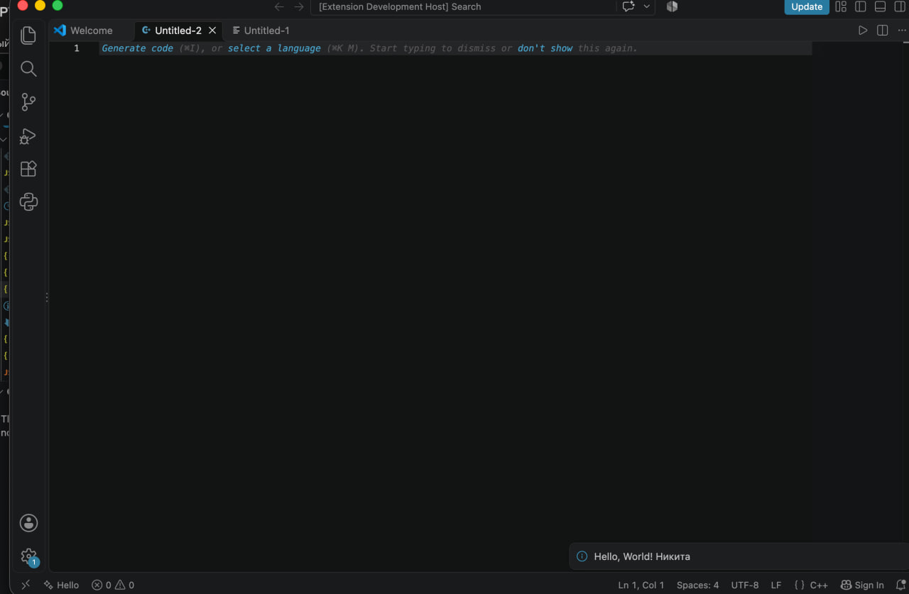
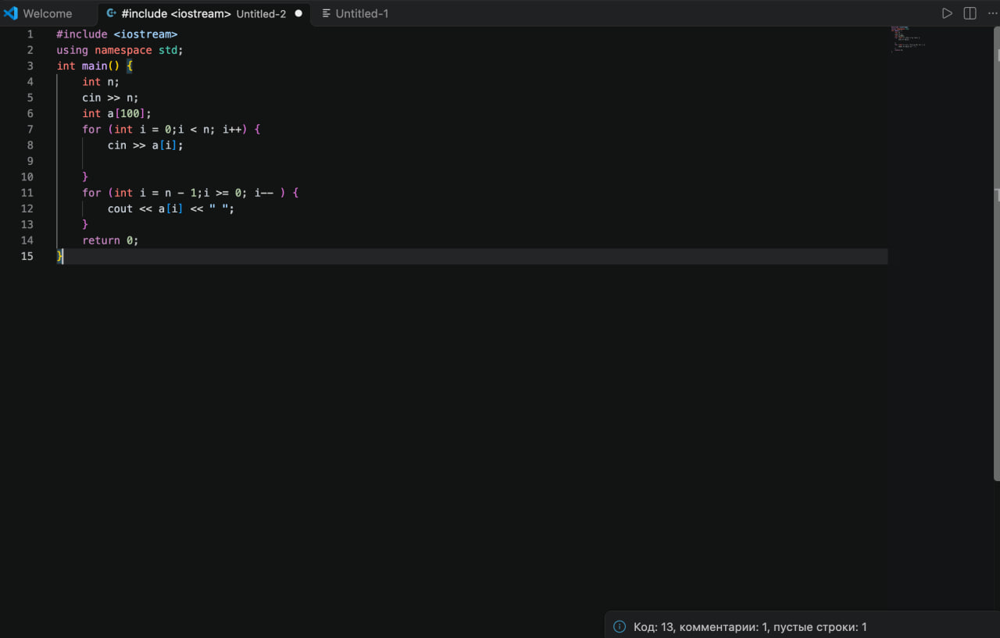
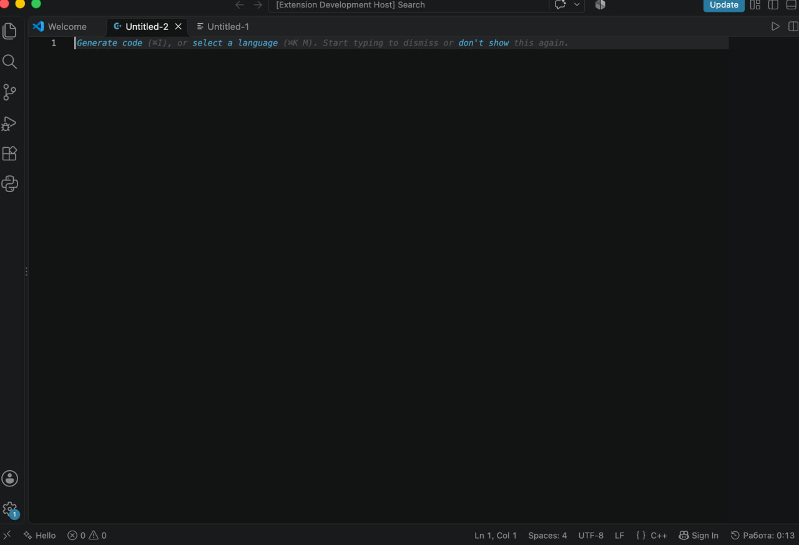
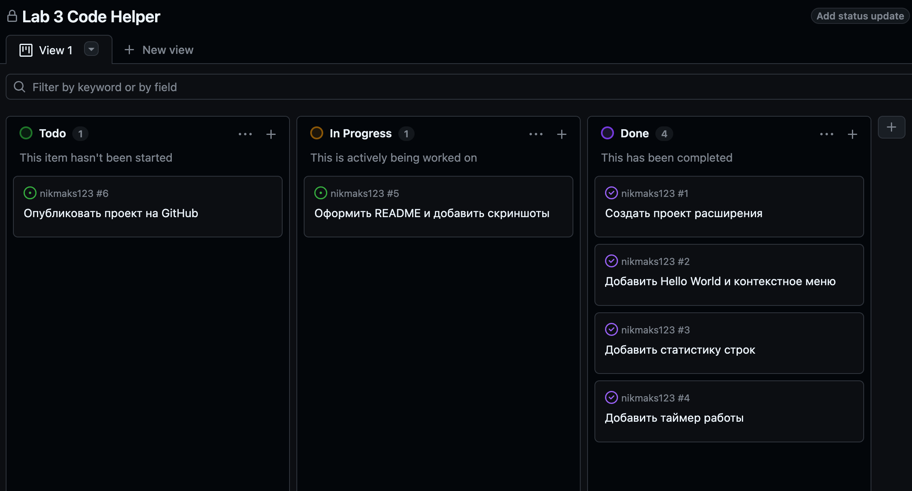

# Lab 3 Code Helper

**Автор:** [Филипенко Никита Михайлович], группа [M3125]

Расширение для VS Code с приветствием, статистикой строк и таймером работы.

## Возможности

- Кнопка **Hello** показывает сообщение «Hello, World! Никита».
- Пункт **Hello World** доступен в контекстном меню редактора.
- Команда **Статистика строк** считает строки с кодом, комментариями и пустые строки в открытом файле.
- Таймер показывает время работы в статус-баре. Нажатие на него сбрасывает таймер.

### Скриншоты

## Как запустить

1. Откройте папку проекта в VS Code.
2. Нажмите **F5**.
3. В открывшемся окне Extension Development Host используйте кнопку **Hello** или нажмите **⇧⌘P** и выберите **Статистика строк**.

## История коммитов

- Добавлено приветствие Hello World и контекстное меню.
- Добавлена статистика строк текущего файла.
- Добавлен таймер работы с возможностью сброса.

## Планирование

